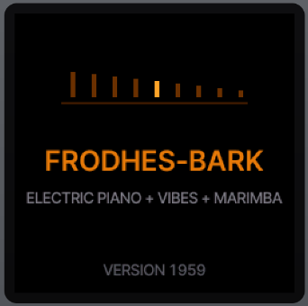
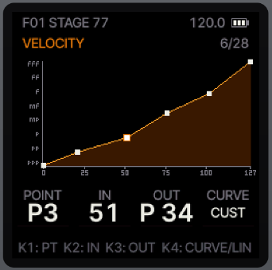

# Frodhes-Bark

**A physically modeled electric piano, vibraphone, and marimba for the M-VAVE FM-1, SMK-37, and Akai MPC — with calibrated Rhodes bark, Wurlitzer 140B & 200A reed models, studio stereo effects, and a 6-point velocity curve editor.**

This is a fork of [Frodhes](https://leonardomirabal.github.io/frodhes/) — thank you to Leonardo Mirabal and all upstream contributors for building an extraordinary instrument!

No samples: every note is calculated live as you play it, from the physical equations of the real instrument. A hammer strikes a tine or reed and a pickup turns its motion into sound; a mallet strikes a bar and its resonator rings along. Play softly and it is warm and singing; dig in and it barks or rings.

## What's new in Frodhes-Bark

- **Calibrated Rhodes bark & low-end tuning**: Pickup drive geometry calibrated against acoustic Rhodes recordings for rich, expressive overtone growl with smooth velocity onset and accurate bass pitch behavior (`STAGE 77`, `SUITCASE`, `EARLY FELT`, `BELL DYNO`).
- **Physically modeled Wurlitzer 140B & 200A**: Full electrostatic comb-pickup reed models (`WURLI 140B` and `WURLI 200A`) calibrated against real hardware 200A recordings, plus 12 dedicated Wurlitzer factory presets (`F20–F31`).
- **Studio stereo FX upgrades**: Ping-pong stereo delay, true-stereo Dimension-style chorus, 75° stereo phaser, smooth interpolated touch wah, hall pre-damping, and improved stereo spread / autopan routing.
- **6-point Velocity Curve editor (`VELOCITY`)**: Pianoteq-style customizable 6-point velocity curve (`LIN`, `BARK`, `HVY`, `LGT`, `SOFT`, `CUST`) with live NoteOn/NoteOff velocity bars.
- **Black-Key Velocity Offset (`KEY OFFSET`)**: Global signed velocity offset (`-64..+64`) for black keys, applied before the velocity curve to compensate for controllers with hotter black-key response.
- **Akai MPC Standalone & SMK-37 support**: Prebuilt packages for **M-VAVE FM-1** (dual-core `--c1`), **SMK-37 Pro / Elite / MKE-P37**, and **Akai MPC Standalone** (`arm32` + `arm64`, distinct `Frodhes-Bark` plugin identity so it can coexist alongside stock Frodhes).

<table align="center">
  <tr>
    <td align="center" width="50%"><br>Frodhes-Bark booting on the M-VAVE FM-1</td>
    <td align="center" width="50%"><br><b>6-point Velocity Curve editor</b></td>
  </tr>
</table>

You can also try Frodhes-Bark in the browser, no flashing needed, in the free community [FM-1 Emulator](https://fm1-emulator.atst.tools/) by loading the latest `frodhes-bark-<version>-c1.fwsc` from the [releases page](https://github.com/areichow/frodhes-bark/releases/latest).

## What you get

- **Eight instruments**: six electric pianos (`STAGE 77`, `SUITCASE`, `EARLY FELT`, `BELL DYNO`, `WURLI 140B`, `WURLI 200A`), a vibraphone with its motor (`VIBES`), and a marimba (`MARIMBA`).
- **Effects**: compressor, 3-band EQ, drive with five overdrive types, resonant filter with its own LFO, tremolo / pan / touch wah, stereo phaser, true-stereo chorus, stereo ping-pong delay (digital, analog, tape), and full-rate reverb (hall, plate, infinite).
- **For playing**: sustain pedal, 6-point velocity curve, black-key velocity offset, velocity from the FM-1's own keys, chords, scales, arpeggiator, a pattern recorder (1–16 bars, overdub, undo, per-step chance), tap tempo, and MIDI clock sync.
- **Connections**: MIDI over USB and TRS input, pitch bend, audio over USB (to a computer, phone, or tablet), and headphone jack.
- **Presets**: 31 factory sounds (`F01–F31`, including 12 Wurlitzer presets) and 16 user slots (`U01–U16`) on FM-1 / SMK-37; 69 factory presets on Akai MPC.
- **A screen you can read**: one page at a time, one card per knob.

What is new in each release: [Frodhes-Bark releases](https://github.com/areichow/frodhes-bark/releases).

## Versioning & firmware identity

Frodhes-Bark uses a **permanent firmware identity (`1968`**, the launch year of the Wurlitzer 200) across all hardware builds (`FM-1_1968`, `SMK-37 Pro_1968`, `SMK-37 Elite_1968`, `MKE-P37_1968`) so firmware updaters and [The Firmware Hub](https://thefirmwarehub.com) recognize it consistently across updates.

Rolling releases are versioned by date (`YYYYMMDD.N`, e.g. `20261122.0`), displayed on the boot splash screen, the `MIDI` page's `VERSION` card, and the `SETUP` footer.

## Install on the M-VAVE FM-1

1. Download the latest `frodhes-bark-<version>-c1.fwsc` from the [releases page](https://github.com/areichow/frodhes-bark/releases/latest).
2. Connect the FM-1 over USB and install it from a browser (Chrome or Edge) via [The Firmware Hub](https://thefirmwarehub.com) or the [upstream web installer](https://leonardomirabal.github.io/frodhes/#install), or from a terminal:
   ```sh
   pip install mido python-rtmidi
   python3 tools/fm1_install.py frodhes-bark-<version>-c1.fwsc
   ```
3. If something goes wrong, switch the FM-1 off, hold **OCT−**, and switch it on. This starts the USB rescue loader so you can flash again.

**Both cores.** Frodhes-Bark runs the voices on one of the FM-1's two processor cores and the effects on the other: 14 voices on every instrument, full-rate reverb, and low MIDI-to-audio latency (~6.5 ms). Both the Puya `P25Q80` (`0x856014`) and newer `UC25HQ80` (`0xB36014`) flash chips are supported in both the app and update loader.

Your settings and user presets are preserved across updates (including migrating from 19-preset Frodhes layouts). You can always go back to M-VAVE's original firmware: [how](docs/MANUAL.md#going-back-to-the-original-firmware).

## Other supported hardware

Download all builds from the [releases page](https://github.com/areichow/frodhes-bark/releases/latest):

| Device | Release file | Notes |
| --- | --- | --- |
| **M-VAVE FM-1** | `frodhes-bark-<version>-c1.fwsc` | Dual-core, 14 voices, full-rate reverb (`FM-1_1968`) |
| **SMK-37 Pro** | `frodhes-bark-<version>-smk37.fwsc` | 10 voices (`SMK-37 Pro_1968`) — see [docs/SMK37.md](docs/SMK37.md) |
| **SMK-37 Elite** | `frodhes-bark-<version>-smk37-elite.fwsc` | 10 voices (`SMK-37 Elite_1968`) — see [docs/SMK37.md](docs/SMK37.md) |
| **MKE-P37** | `frodhes-bark-<version>-smk37-mke.fwsc` | 10 voices (`MKE-P37_1968`) — see [docs/SMK37.md](docs/SMK37.md) |
| **Akai MPC Standalone** | `frodhes-bark-<version>-mpc.zip` | `arm32` + `arm64`, 16 voices, 69 presets, MPC OS 3.10.1+ — see [docs/MPC.md](docs/MPC.md) |

## Manual & documentation

The user manual is inherited from upstream Frodhes and is a great starting point for every page, knob, button, effect, and MIDI CC:

- **[The user manual](docs/MANUAL.md)**
- **[Rhodes physical model spec](docs/model/RHODES_PHYSICS.md)**
- **[Wurlitzer 140B / 200A physical model spec](docs/model/WURLITZER_PHYSICS.md)**


## Credits

Frodhes-Bark is a fork of [Frodhes](https://github.com/leonardoMirabal/frodhes) by leonardoMirabal.
Frodhes is built on [Dinghy](https://github.com/zvenson/dinghy) by zvenson, which uses the platform of
[Felucca](https://github.com/hugelton/Felucca) by Leo Kuroshita (Hügelton Instruments) as
[SLOOP](https://github.com/isod89/sloop-fm1) by isod89 carries it. That platform handles updates, the USB rescue,
USB MIDI and audio, the panel, the screen, and the settings. MIDI pitch bend is genkigenki's work
([PR #3](https://github.com/leonardoMirabal/frodhes/pull/3)). Key velocity on the FM-1's keys follows Charles
Vestal's [fm1-velocity](https://github.com/charlesvestal/fm1-velocity).

## For developers

How to build, test, and contribute: [docs/BUILD.md](docs/BUILD.md) and [CONTRIBUTING.md](CONTRIBUTING.md).
To build all 5 release artifacts for the current `VERSION`, run `make dist`. To validate `fmhub.json`, build, push, and create a GitHub release, run `make publish`.

## Support

Frodhes-Bark is free. If you enjoy it, you can [buy the original Frodhes developer a coffee](https://ko-fi.com/leomirabal).

## License and disclaimer

GPL-3.0-only, the same as Frodhes, Dinghy, Felucca, and SLOOP ([LICENSING.md](LICENSING.md)).

Frodhes-Bark is an independent open-source project, not affiliated with or endorsed by M-VAVE, Akai, or the trademark owners of Rhodes, Fender, Wurlitzer, or any instrument maker. It comes with no warranty: install it at your own risk.
